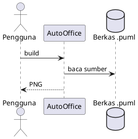
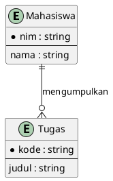
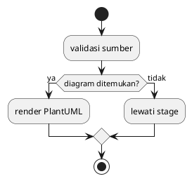

# Diagram PlantUML

AutoOffice memakai PlantUML sebagai mesin diagram untuk naskah DOCX dan deck.
Sumber diagram berupa berkas `.puml` atau isi code fence PlantUML. AutoOffice
menjalankan PlantUML secara lokal, menerima PNG, lalu menyisipkan PNG itu ke
DOCX atau PPTX. Tidak ada server, browser, Node.js, Chromium, atau Graphviz
yang dibutuhkan.

## Daftar Isi

- [Dua jalur pemakaian](#dua-jalur-pemakaian)
- [Prasyarat dan instalasi](#prasyarat-dan-instalasi)
- [Variabel lingkungan](#variabel-lingkungan)
- [Sintaks dasar](#sintaks-dasar)
- [Fence DOCX](#fence-docx)
- [Block diagram di deck](#block-diagram-di-deck)
- [Jenis diagram yang didukung](#jenis-diagram-yang-didukung)
- [Smetana dan Graphviz](#smetana-dan-graphviz)
- [Cache dan output](#cache-dan-output)
- [Keamanan dan batas](#keamanan-dan-batas)
- [Troubleshooting](#troubleshooting)
- [Referensi](#referensi)

## Dua jalur pemakaian

| Target | Tempat menulis | Bentuk sumber | Output |
| --- | --- | --- | --- |
| DOCX | `document.md` | fence `{.plantuml caption="..."}` | `gambar/plantuml-<hash>.png` di workspace |
| Deck | `deck.yaml` | block `diagram` dengan `source` `.puml` | PNG di cache render |

Keduanya memakai engine PlantUML yang sama. Perbedaan utamanya ada pada cara
menulis sumber: DOCX menerima isi diagram langsung di dalam Markdown, sedangkan
deck menunjuk satu berkas `.puml` relatif terhadap `deck.yaml`.

## Prasyarat dan instalasi

Diagram memerlukan dua komponen langsung:

- Java 21.
- PlantUML 1.2026.10 atau lebih baru, berupa `plantuml.jar` atau executable
  `plantuml`.

AutoOffice tidak memasang keduanya. Tidak ada Node.js, Chromium, browser,
atau Graphviz yang perlu dipasang.

### Java 21

Periksa versi Java dari shell yang sama dengan tempat build dijalankan:

```bash
java -version
```

Keluaran harus menyebut versi 21 atau lebih baru. Bila Java tidak ada di
`PATH`, set `AUTOOFFICE_JAVA` ke executable `java`. `JAVA_HOME` juga diterima
sebagai fallback.

### PlantUML 1.2026.10

PlantUML 1.2026.10 adalah rilis stabil 2026-11-11. Unduh
`plantuml-1.2026.10.jar` dari halaman rilis resmi:

- [PlantUML download](https://plantuml.com/download)
- [Rilis PlantUML 1.2026.10](https://github.com/plantuml/plantuml/releases/tag/v1.2026.10)

Simpan jar di lokasi tetap, misalnya `tools/plantuml-1.2026.10.jar`, lalu
periksa:

```bash
java -jar tools/plantuml-1.2026.10.jar --version
```

Alternatifnya, gunakan launcher `plantuml` dari manajer paket atau skrip
pembungkus yang menjalankan versi yang sama. Launcher harus dapat dijalankan
langsung dari shell.

### Pemeriksaan doctor

```bash
uv run autooffice doctor
```

`doctor` menampilkan baris `plantuml` berisi path engine dan versinya bila
terbaca. Bila PlantUML tidak ditemukan, baris itu tetap dilaporkan dan build
yang memuat diagram akan berhenti dengan pesan instalasi. Dokumen dan deck tanpa
diagram tidak memerlukan PlantUML.

## Variabel lingkungan

| Variabel | Wajib | Isi |
| --- | --- | --- |
| `AUTOOFFICE_PLANTUML` | untuk diagram | Path ke `plantuml.jar` atau executable `plantuml`. |
| `AUTOOFFICE_JAVA` | opsional | Path ke executable `java`; dipakai bila `AUTOOFFICE_PLANTUML` menunjuk jar. |
| `JAVA_HOME` | opsional | Fallback lokasi Java bila `AUTOOFFICE_JAVA` tidak diisi. |

Bila `AUTOOFFICE_PLANTUML` tidak diisi, AutoOffice mencari `plantuml` di `PATH`.
Bila `AUTOOFFICE_JAVA` tidak diisi dan engine berupa jar, AutoOffice mencari
`java` lewat `JAVA_HOME` lalu `PATH`.

Linux atau macOS:

```bash
export AUTOOFFICE_PLANTUML="$HOME/tools/plantuml-1.2026.10.jar"
export AUTOOFFICE_JAVA="/usr/lib/jvm/java-21/bin/java"  # opsional
```

Windows PowerShell:

```powershell
$env:AUTOOFFICE_PLANTUML = "C:\tools\plantuml-1.2026.10.jar"
$env:AUTOOFFICE_JAVA = "C:\Program Files\Eclipse Adoptium\jdk-21\bin\java.exe"
```

Nilai path yang menunjuk berkas yang tidak ada dianggap tidak ditemukan. Jangan
mengandalkan variabel `PLANTUML_SECURITY_PROFILE`; AutoOffice selalu menjalankan
PlantUML dengan `-secure`.

## Sintaks dasar

Satu berkas `.puml` sebaiknya memuat tepat satu diagram yang dibatasi
`@startuml` dan `@enduml`. Baris komentar dimulai dengan tanda kutip tunggal.
Nama peserta dapat diberi alias dengan `as`.

Sequence diagram:



Entity relationship diagram:



Activity diagram:



Gunakan satu diagram per berkas `.puml` agar nama berkas, cache, dan pesan error
mudah ditelusuri. Untuk DOCX, satu code fence juga berisi satu diagram.

## Fence DOCX

Tulis diagram langsung di `document.md` sebagai code fence dengan caption wajib:

````markdown
```{.plantuml caption="Alur build DOCX"}
@startuml
start
:document.md;
:render PlantUML;
:DOCX;
stop
@enduml
```
````

Aturan fence DOCX:

- atribut `caption` wajib dan tidak boleh kosong;
- isi diagram tidak boleh kosong;
- fence penutup wajib ada;
- fence biasa seperti `python`, `bash`, atau `json` tidak disentuh;
- caption menjadi alt text gambar, bukan nomor manual.

Stage `plantuml` mengganti fence dengan:

```markdown

```

PNG ditulis ke `.laporan-build/gambar/plantuml-<hash>.png` di samping
`document.md`. Nomor `Gambar bab.n` diberikan stage caption DOCX. Jangan menulis
nomor gambar di Markdown.

`check` tidak merender PlantUML. Caption dan isi fence baru diperiksa saat
build oleh stage `plantuml`; build baru memerlukan PlantUML bila ada blok yang
belum memiliki PNG.

## Block diagram di deck

```yaml
- id: diagram1
  type: diagram
  source: "diagrams/01-flowchart.puml"
  alt: "Diagram alur pengajuan cuti"
  caption: "Gambar 1. Flowchart pengajuan cuti."
```

Aturan block diagram:

- `source` wajib dan menunjuk tepat satu berkas `.puml`;
- path relatif terhadap direktori `deck.yaml`, memakai `/`, dan tidak boleh
  keluar dari root deck;
- `alt` wajib non-kosong;
- `caption` opsional dan menjadi key teks, bukan alt;
- PlantUML tidak ditulis inline di YAML;
- `check` memvalidasi schema, path, dan alt tanpa merender;
- `build` merender PNG dan menempatkannya sebagai picture native di PPTX atau
  Google Slides.

Contoh demo memakai block ini pada `s15` dan `s21`. Lihat juga
[kontrak PlantUML](../contracts/plantuml.md) dan
[panduan deck](deck-authoring.md).

## Jenis diagram yang didukung

AutoOffice meneruskan sumber ke PlantUML 1.2026.10. Jenis diagram yang umum
dipakai:

| Keluarga | Contoh | Catatan |
| --- | --- | --- |
| UML perilaku | sequence, activity, timing | Tidak memerlukan layout Graphviz. |
| UML perilaku berlayout | use case, state | Layout memakai Smetana. |
| UML struktur | class, object, component, deployment | Layout memakai Smetana. |
| Data | entity relationship (IE dan Chen) | Entitas, atribut, dan relasi. |
| Perencanaan | mindmap, WBS, gantt | Cocok untuk jadwal dan rincian pekerjaan. |
| Data tekstual | JSON, YAML | Menampilkan struktur data. |
| Lainnya | network, archimate, salt, regex | Selama PlantUML mendukung output PNG. |

AutoOffice tidak membatasi daftar jenis diagram. Batasannya adalah format
keluaran PNG, direktif yang dilarang `-secure`, dan kemampuan layout Smetana.

## Smetana dan Graphviz

PlantUML secara default memakai Graphviz `dot` eksternal untuk sebagian jenis
diagram. AutoOffice selalu menambahkan `--pragma layout=smetana`, sehingga
layout memakai Smetana, port Graphviz ke Java yang tertanam di PlantUML.
Konsekuensinya:

- Graphviz tidak perlu dipasang.
- Tidak ada proses `dot` eksternal, browser, atau server.
- Bentuk layout dapat sedikit berbeda dari Graphviz, misalnya panah lebih
  lurus.
- Fitur yang hanya tersedia di Graphviz dapat gagal atau tampil berbeda.

Jangan menambahkan `!pragma layout graphviz` atau `!pragma layout elk` ke
sumber. AutoOffice tidak menyediakan Graphviz atau ELK, dan pragma itu dapat
membuat render gagal. `!pragma layout smetana` boleh ditulis, tetapi redundan
karena sudah menjadi default AutoOffice.

## Cache dan output

Output selalu PNG dengan dpi 192. AutoOffice tidak menerima SVG, PDF, atau
gambar error PlantUML sebagai output diagram.

Untuk deck, cache persisten berada di `.autooffice/cache/plantuml/` dan
workspace render memakai `cache/plantuml/`. Nama berkas:

```text
plantuml-<sha256>.png
```

Cache key SHA-256 dihitung dari:

- isi berkas `.puml`;
- fingerprint theme deck, termasuk warna background;
- versi PlantUML yang dipakai;
- opsi render: PNG, Smetana, dpi 192, background theme, dan `-secure`.

Setiap PNG cache memiliki sidecar `.json` berisi metadata yang sama. Bila isi
sumber, theme, versi PlantUML, atau opsi render berubah, cache key berubah dan
diagram dirender ulang. PNG cache yang rusak dihapus lalu dirender ulang. Cache
valid dapat dipakai tanpa memanggil PlantUML bila engine tidak tersedia.

Untuk DOCX, nama PNG dihitung dari isi diagram yang dinormalisasi dan opsi
render, lalu dipotong menjadi 12 karakter. Diagram identik dalam satu build
hanya dirender sekali. PNG yang sudah ada di `.laporan-build/gambar/` dipakai
ulang tanpa memanggil PlantUML. Workspace dihapus setelah build kecuali memakai
`--keep-intermediate`.

Dengan `--keep-intermediate`, isi `.laporan-build/` atau
`.autooffice-build/<stem>/` dapat diperiksa. Jangan menyalin PNG hasil render
menjadi sumber; sumber tetap berkas `.puml` atau blok PlantUML di `document.md`.

## Keamanan dan batas

Diagram diperlakukan sebagai input tidak tepercaya.

- PlantUML dijalankan lokal dengan `-secure`. Direktif yang membaca berkas atau
  URL, termasuk `!include`, ditolak.
- Sumber dikirim lewat stdin; PNG diterima lewat stdout dengan `-pipe`.
- Tidak ada server, jaringan, browser, atau upload diagram.
- Path `source` deck wajib relatif, memakai `/`, dan tetap di dalam root deck.
- Path absolut, UNC, drive letter, backslash, URL remote, dan segmen `..`
  ditolak.
- Sumber `.puml` deck dibatasi 1.000.000 byte.
- Render dibatasi 180 detik dan probe versi 30 detik.
- Renderer deck membatasi output PNG 64 MiB dan keluaran teks proses 64 KiB.
- Stage DOCX membatasi output PNG 32 MiB.
- Render memakai `--threads 1`, `--stop-on-error`, dan `--no-error-image`.
- Kegagalan tidak menghasilkan fallback teks, shape, SVG, screenshot, atau PNG
  setengah jadi.

Karena `!include` dilarang, diagram yang membutuhkan potongan bersama harus
menyalin isi potongan itu ke dalam `.puml` atau fence. AutoOffice tidak
menyediakan mekanisme include lokal.

## Troubleshooting

| Kode atau gejala | Sebab | Tindakan |
| --- | --- | --- |
| `PLANTUML-TOOL` | PlantUML tidak ditemukan | Set `AUTOOFFICE_PLANTUML` ke jar atau launcher, atau pasang `plantuml` di `PATH`. |
| `PLANTUML-JAVA` | Java tidak ditemukan atau gagal dijalankan | Pasang Java 21 dan set `AUTOOFFICE_JAVA` bila perlu. |
| `PLANTUML-VERSION` | Versi PlantUML tidak terbaca atau terlalu lama | Pakai PlantUML 1.2026.10 atau lebih baru. |
| `PLANTUML-SOURCE` | Path, ekstensi, atau ukuran sumber salah | Pastikan `.puml`, path relatif, dan berada di dalam root deck. |
| `PLANTUML-INPUT` | Caption atau isi fence DOCX tidak valid | Tambahkan `caption="..."`, isi diagram, dan fence penutup. |
| `PLANTUML-SYNTAX` | Sintaks PlantUML salah | Perbaiki sumber; lihat pesan baris dari PlantUML. |
| `PLANTUML-TIMEOUT` | Render melebihi 180 detik | Pecah diagram atau sederhanakan layout. |
| `PLANTUML-OUTPUT` | PlantUML tidak menghasilkan PNG valid | Periksa jar dan coba render sumber yang lebih kecil. |
| `PLANTUML-CACHE` | Cache tidak dapat dibaca atau ditulis | Periksa izin dan ruang disk `.autooffice/cache/`. |
| `PLANTUML-FAILED` | Proses PlantUML keluar dengan kode error | Periksa pesan stderr dan versi engine. |
| `PLANTUML-NO-DIAGRAM` | Sumber tidak memuat diagram | Bungkus isi dengan `@startuml` dan `@enduml`. |

Pemeriksaan awal:

```bash
uv run autooffice doctor
java -version
java -jar <path>/plantuml-1.2026.10.jar --version
```

Bila `doctor` menemukan engine tetapi build gagal, jalankan PlantUML langsung
pada sumber bermasalah:

```bash
java -jar <path>/plantuml-1.2026.10.jar --check-syntax diagrams/01-flowchart.puml
```

Gejala `Could not run dot` atau `Graphviz` berarti sumber memaksa layout
Graphviz. Hapus `!pragma layout graphviz` dan biarkan AutoOffice memakai
Smetana. Jangan memasang Graphviz untuk memperbaikinya.

Bila diagram tidak berubah setelah sumber diedit, pastikan berkas `.puml` yang
dirujuk memang berubah dan tidak ada PNG lama dengan nama hash yang sama.
Hapus `.autooffice/cache/plantuml/` bila perlu, lalu build ulang.

Bila path mengandung spasi, bungkus nilai environment dengan tanda kutip.
Pastikan shell yang menjalankan `uv run autooffice` adalah shell yang sama
dengan tempat variabel diatur.

## Referensi

- [PlantUML](https://plantuml.com/)
- [PlantUML command line](https://plantuml.com/command-line)
- [PlantUML security](https://plantuml.com/security)
- [Smetana layout](https://plantuml.com/smetana02)
- [PlantUML download](https://plantuml.com/download)
- [Sequence diagram](https://plantuml.com/sequence-diagram)
- [Class diagram](https://plantuml.com/class-diagram)
- [Activity diagram](https://plantuml.com/activity-diagram-beta)
- [Entity relationship diagram](https://plantuml.com/ie-diagram)

Bila render gagal, lihat [troubleshooting.md](troubleshooting.md). Kontrak
normatifnya ada di [kontrak PlantUML](../contracts/plantuml.md).
